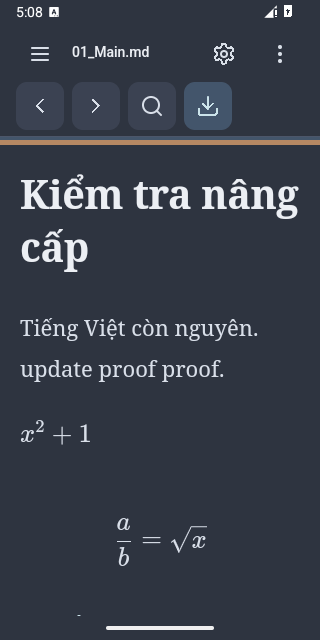
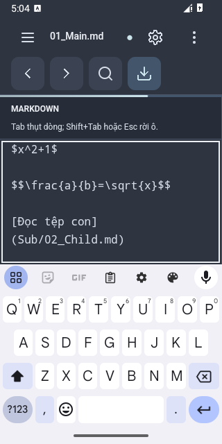
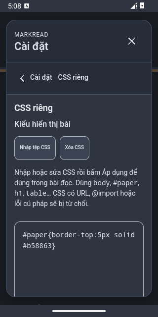

# MarkRead — Quiet Ink

Đọc và chỉnh sửa Markdown trên Android, ngay trên thiết bị. MarkRead dành không gian cho nội dung, với giao diện Quiet Ink, 12 theme và công cụ chỉnh sửa gọn gàng.

**v1.2.0 · Android 8.0+ · Android System WebView 100+ · Offline · Không tài khoản**

[GitHub Releases](https://github.com/thanhnguyen0203/MarkRead/releases) · [Hướng dẫn cài đặt và sử dụng](HUONG_DAN_CAI_DAT.md) · [Có gì mới trong 1.2.0](docs/release/RELEASE_NOTES_v1.2.0_VI.md)

> Các liên kết v1.2.0 bên dưới chỉ hoạt động khi bản phát hành được duyệt và xuất bản. Nếu chưa thấy v1.2.0 trên trang Releases, bản đó chưa được công bố; Draft chỉ dành cho người có quyền review. Không dùng APK cũ thay cho artifact 1.2.0.

## Không gian đọc của bạn

<p>
  
  
  
</p>

Ảnh thật từ emulator API 35, viewport 320 × 640, trong kiểm thử nâng cấp P4C. Nội dung là fixture thử nghiệm, không phải dữ liệu người dùng; đây không phải ảnh thiết bị vật lý hoặc mockup.

## Tính năng chính

- **Đọc Markdown:** bảng, khối mã, mục lục, LaTeX, Mermaid và ảnh raster cục bộ trong phạm vi được cấp quyền.
- **Chỉnh sửa:** chế độ Nguồn hoặc sửa từng khối trong chế độ hợp nhất; xuất bản sao Markdown bằng hộp lưu Android.
- **Thư viện:** cây thư mục con, lọc tên, sắp xếp theo số tự nhiên, tệp trước/sau và đổi tên bằng long-press.
- **Tìm và thay thế:** trong nguồn của bài hiện tại; hỗ trợ hoa/thường, regex, thay một/thay tất cả và Undo/Redo.
- **Cá nhân hóa:** 12 theme, font hệ thống/serif/Merriweather/monospace, cỡ chữ, giãn dòng, độ rộng bài và CSS riêng được kiểm tra trước khi áp dụng.
- **Quiet Ink:** Settings theo nhóm, toolbar và menu nhất quán, 23 Lucide SVG offline, launcher Open Book, focus bàn phím và chuyển động ngắn có reduced motion.

## Tải và cài đặt

Khi v1.2.0 được xuất bản, tải hai file trong [release v1.2.0](https://github.com/thanhnguyen0203/MarkRead/releases/tag/v1.2.0):

- [MarkRead-v1.2.0.apk](https://github.com/thanhnguyen0203/MarkRead/releases/download/v1.2.0/MarkRead-v1.2.0.apk) — 7.184.639 byte.
- [MarkRead-v1.2.0.sha256](https://github.com/thanhnguyen0203/MarkRead/releases/download/v1.2.0/MarkRead-v1.2.0.sha256) — checksum của đúng APK này.

Mở APK trong trình quản lý tệp và cho phép ứng dụng đó cài APK khi Android yêu cầu. MarkRead phân phối trực tiếp qua GitHub Releases, không qua Google Play. [Hướng dẫn chi tiết, kiểm checksum và xử lý cập nhật](HUONG_DAN_CAI_DAT.md).

**Trước khi cập nhật, lưu bản sao của mọi sửa đổi cần giữ.** Cài đè lên bản release cùng chữ ký; không cần gỡ app. Không uninstall hoặc xóa dữ liệu để vượt lỗi chữ ký. Bản debug dùng chứng chỉ khác; hãy kiểm tra nguồn APK nếu Android từ chối cập nhật.

## File và quyền riêng tư

Mở **Danh sách tệp → Mở → Mở thư mục** hoặc **Mở tệp**, rồi chọn phạm vi qua bộ chọn hệ thống Android (SAF). App chỉ truy cập tệp/thư mục được chọn; không yêu cầu quyền toàn bộ bộ nhớ.

MarkRead không khai báo quyền Internet, không tài khoản, quảng cáo, analytics hoặc telemetry. Thư viện render, công thức, sơ đồ, icon và font được gói sẵn; nội dung không gửi tới máy chủ. Android và nhà cung cấp tệp do người dùng chọn có chính sách riêng; dùng vị trí lưu trữ cục bộ để đọc hoàn toàn ngoại tuyến.

Settings/CSS tự lưu trên thiết bị. Bản sửa chưa xuất nằm trong RAM; không có autosave nội dung hoặc cloud sync. File gốc không tự bị ghi đè khi chỉnh sửa. Xem [quy tắc phiên đọc và lưu bản sao](HUONG_DAN_CAI_DAT.md#phiên-đọc-và-cài-đặt).

## Kiểm chứng và giới hạn

P4C đạt **2.385/2.385 automated checks**, palette **2.220/2.220**, kiểm APK **18/18** và **44/44 native upgrade assertions**. Cài đè release thực 1.1.5/code 115 → 1.2.0/code 120 trên emulator API 35 giữ Settings, CSS, quyền SAF và byte các file đã lưu. Đây là kết quả P4C được kế thừa; P4D chỉ kiểm lại artifact và tài liệu. [Báo cáo ký/build](docs/release/P4C_REPORT.md) · [Bằng chứng nâng cấp](docs/release/P4C_UPDATE_VALIDATION.md).

- Máy thật, API 26, OEM/provider khác và mọi biến thể IME chưa được nghiệm thu đầy đủ; không tuyên bố tương thích mọi thiết bị hoặc 60 FPS.
- TalkBack: **NOT TESTED — accepted limitation**; semantic HTML, ARIA và focus hiện có vẫn được giữ.
- Một số lỗi SAF provider có thể hiện thông tin kỹ thuật tiếng Anh.
- Undo dùng history textarea của WebView, không cam kết xuyên field/file/reload hoặc qua cập nhật. Xuất draft trước khi rời app lâu, đóng app hay cập nhật.
- Mỗi tài liệu tối đa 5 MiB; cây tối đa 5.000 mục/32 cấp, mỗi ảnh 10 MiB và tối đa 8 sơ đồ/bài. Ảnh Internet/SVG, CSS có URL hoặc `@import` bị chặn.

## Mã nguồn và build

Kiến trúc **Java Android + WebView**, giao diện HTML/CSS/JavaScript. Không Compose hoặc framework UI mới. Package `vn.markread.local`, versionName `1.2.0`, versionCode `120`, minSdk 26, target/compileSdk 35.

Gradle 8.9 · AGP 8.7.3 · JDK 17. Mở dự án bằng Android Studio hoặc dùng PowerShell:

```powershell
.\scripts\Build-AndroidDebug.ps1 -Offline -RerunTasks
# Chỉ build release khi có đúng khóa cũ và cấu hình local/env an toàn:
.\scripts\Build-AndroidRelease.ps1 -Offline -RerunTasks
```

`-Offline` cần SDK và Gradle dependency cache đã được chuẩn bị. Source public có sẵn renderer, không có signing material. Release signing kiểm fingerprint công khai trong `gradle/release-certificate.sha256` và từ chối khi thiếu/sai khóa; không tự sinh khóa. Không commit keystore, password hoặc cấu hình máy cá nhân. Xem [cấu hình và giới hạn build P4C](docs/release/P4C_REPORT.md).

Khi sửa renderer: `cd web`, `npm ci`, `npm test`, `npm run build`, rồi đồng bộ `web/dist/MarkRead.html` vào `app/src/main/assets/index.html`. Việc chuẩn bị dependencies có thể cần mạng; ứng dụng đã đóng gói chạy offline. Không chuẩn hóa line endings của các đầu vào build đã pin trong `.gitattributes`, đặc biệt HTML chứa CSP hash. Python builder cũ không phải quy trình tạo APK P4C.

Mã gốc theo [MIT](LICENSE.txt); thư viện/font giữ [thông báo giấy phép riêng](app/src/main/assets/THIRD_PARTY_NOTICES.txt). MarkRead là dự án độc lập, lấy cảm hứng từ MarkText và không thuộc dự án MarkText. Lịch sử phiên bản được giữ trong [CHANGELOG.md](CHANGELOG.md).
