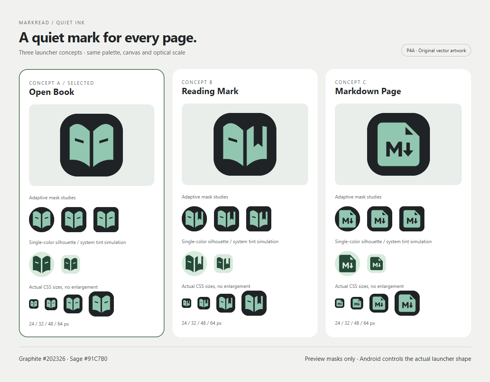
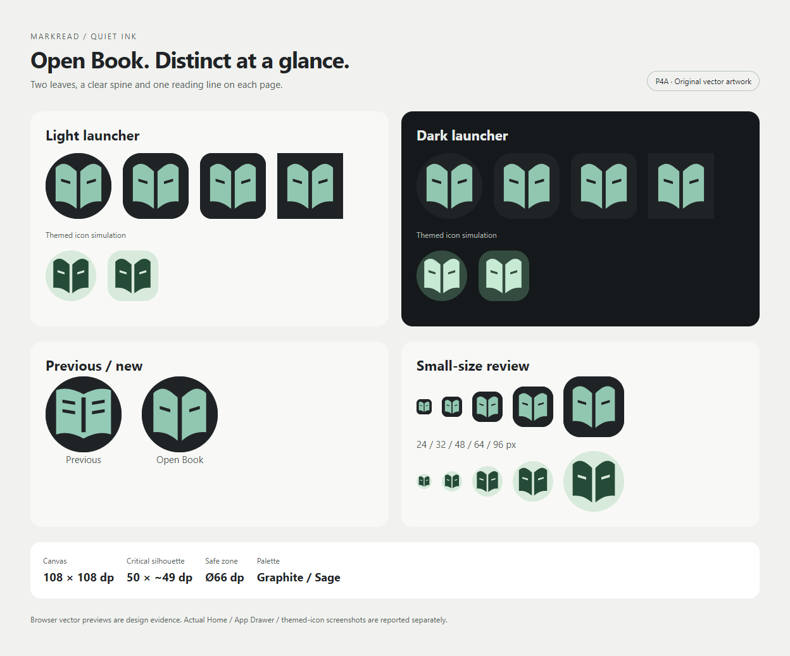
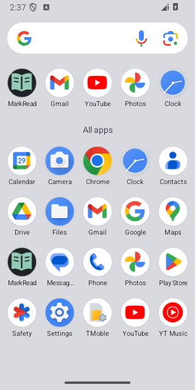
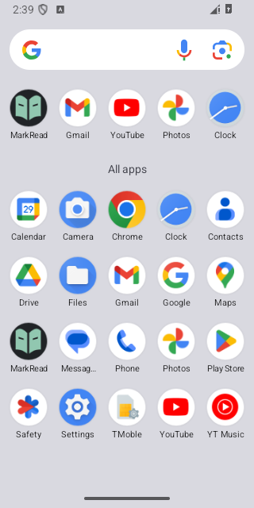
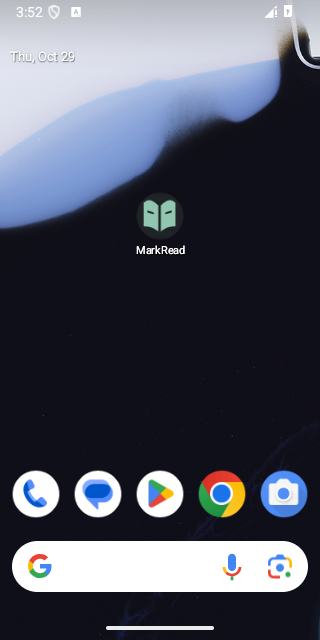
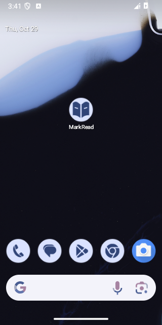
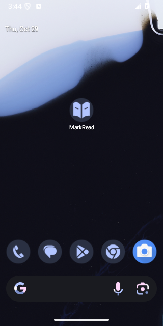

# P4A — MarkRead Professional Launcher Icon

29/10/2026 · **P4A COMPLETE — chờ người dùng đánh giá.** Đã thiết kế ba concept và tích hợp **A / Open Book** vào Android resources. Không thực hiện P4B–P4D.

## Đầu vào và phạm vi

Đã đọc MASTER, ICONS, COMPONENTS, [P3F-R2 readiness](../ui-redesign/P3F_R2_RELEASE_READINESS.md) và readiness/known issues P3F-R. Gate đầu vào: READY FOR P4,2297 automated, palette2220, APK18. Git có sẵn thay đổi P3C–P3F-R2 chưa commit; đã chụp snapshot132 input và Git status ở ignored `build/ui-p4a/before`, không reset/stage/commit hoặc ghi đè những thay đổi đó.

Trước sửa: renderer SHA khớp bản R2 được nghiệm thu; chạy lại Node132/132 và palette2220/2220. Sau sửa: chạy đủ2297 kế thừa. Xem [scope](../../test-results/ui-p4a/SCOPE.json).

P4A của người dùng cho phép thay launcher, thay điều khoản giữ launcher cũ ở tài liệu P1 lịch sử. Brand `mr` trong WebView và23 Lucide UI không đổi. Skill **ui-ux-pro-max** đã được đọc và sử dụng: hình học đơn giản, vector, tính nhất quán, contrast và kiểm tra ở cỡ nhỏ. Truy vấn local về geometric launcher không có bản ghi phù hợp; truy vấn contrast chỉ trả hướng dẫn chung. Không nhận kết quả generic đó làm mẫu logo đã được xác minh; các concept dưới đây là thiết kế riêng từ brief Quiet Ink.

## Ba concept và lựa chọn



- **A — Open Book:** hai lá sách đầy, khe gáy xuyên suốt và một khe đọc trên mỗi trang. Hai đường cong phía trên tạo vòm nhẹ, trục giữa rõ; khoảng âm giữ nhận diện trong monochrome. Mạnh: cân đối, đọc rõ ở24/32/48px, gần công dụng đọc lâu. Yếu: sách là motif phổ biến, nhận diện riêng phụ thuộc tỷ lệ vòm/khe và bảng màu; không biểu thị thao tác sửa trực tiếp.
- **B — Reading Mark:** sách mở với khoảng âm bookmark ở trang phải. Mạnh: gợi vị trí đọc và thao tác đánh dấu. Yếu: trọng lượng lệch về trái, bookmark và trang dễ hòa nhau khi nhỏ; nhiều chi tiết hơn A.
- **C — Markdown Page:** trang gấp góc, chữ M và mũi tên xuống bằng khoảng âm. Mạnh: liên hệ Markdown nhanh, hình trang vững. Yếu: M/mũi tên dễ được hiểu là download; các khe nhỏ kém rõ hơn silhouette sách ở24px, ít cảm giác Quiet Ink hơn A.

Chấm thiết kế nội bộ, không phải khảo sát người dùng: nhận diện35%, cỡ nhỏ30%, cân đối20%, phù hợp Quiet Ink15%; thang1–5. A:4/5/5/5 → **4.65**; B:4/3/4/4 →3.70; C:4/3/4/3 →3.55. Chọn **A** vì thắng ở cỡ nhỏ và cân đối, đồng thời đúng ưu tiên Open Book trong brief. Các path tự vẽ, không chép glyph Lucide hoặc logo sản phẩm khác; không tuyên bố đã khảo sát toàn bộ thị trường/trademark.

## Màu và cấu trúc



- Background graphite **#202326**, accent sage **#91C7B0** từ MASTER; contrast identity/nền **8.272:1**. Không gradient, glow hoặc shadow trong resource.
- Canvas108×108dp. Hình A khoảng50×49.3dp, x29–79, y29.7–79. Khe gáy4 đơn vị và khe đọc3 đơn vị. Canvas offline đo tại10samples/đơn vị: bán kính điểm vẽ lớn nhất31.946, thấp hơn safe radius33; cả ba concept đều nằm trong safe circleØ66. Đây là đo raster có dư địa, không chứng minh hình học hình thức.
- Foreground trong suốt, không tự mask/bo góc. Monochrome đen đục với cùng silhouette và khe trong suốt, dùng even-odd fill; Android tự tint. Không giả khoảng âm bằng graphite, nên themed icon vẫn đúng.
- Preview dùng circle, squircle, rounded square và square, cùng cỡ24/32/48/64/96px. Các mask này là mô phỏng thiết kế; launcher/OEM quyết định mask và normalization thực.
- Hình học/layer theo [Android adaptive icon specification](https://developer.android.com/develop/ui/views/launch/icon_design_adaptive):108dp, safe zone, foreground/background và monochrome. Trang Android hiện chuyển hướng sang URL có nhãn Compose; triển khai MarkRead vẫn là XML/VectorDrawable trên ứng dụng Java, không thêm Compose.

## Tài nguyên và file thay đổi

Nguồn thiết kế có thể chỉnh lại: [concepts.json](../../design/launcher/markread/concepts.json) và [hướng dẫn sinh offline](../../design/launcher/markread/README.md).

**Bốn file có sẵn được cập nhật:**

- `app/src/main/res/drawable/ic_foreground.xml`: hình A sage,108dp.
- `app/src/main/res/drawable/ic_background.xml`: vẫn #202326; chuẩn hóa XML theo generator, không đổi màu.
- `app/src/main/res/mipmap-anydpi-v26/ic_launcher.xml`: foreground/background, tương thích minSdk26.
- `app/src/main/AndroidManifest.xml`: chỉ đổi `roundIcon` từ `@mipmap/ic_launcher` sang `@mipmap/ic_launcher_round`.

**File mới:**

- `res/drawable/ic_monochrome.xml`.
- `res/mipmap-anydpi-v26/ic_launcher_round.xml`.
- `res/mipmap-anydpi-v33/ic_launcher.xml` và `ic_launcher_round.xml`: thêm monochrome riêng API33+, không đưa tag mới vào XML26.
- `res/mipmap-{mdpi,hdpi,xhdpi,xxhdpi,xxxhdpi}/ic_launcher.png` và `ic_launcher_round.png`:10PNG48/72/96/144/192px. Đây là fallback cho consumer cần bitmap, không hạ minSdk hoặc thêm hỗ trợ Android cũ.
- `design/launcher/markread/`: nguồn JSON,9SVG màu/monochrome/foreground, README và4file trong `previous/` giữ đúng thiết kế/XML cũ.
- `scripts/Generate-LauncherIcons.py`, `scripts/Render-LauncherIcons.cjs`, `tests/check_launcher_icons.py`.
- Báo cáo này; `docs/release/assets/p4a/` chứa2sheet HTML/PNG, geometry JSON, ảnh Android; `test-results/ui-p4a/` chứa kết quả/log kiểm thử và hash artifact.

Generator Python chỉ dùng standard library. Renderer dùng Playwright/Chromium QA đã có, không cài dependency, download browser, thêm package hoặc phát request mạng;0 request được quan sát khi render. Không có asset runtime qua CDN. Concept B/C, preview và QA không đóng gói trong app.

## Kiểm tra Android thực tế

Dùng riêng **MarkRead_P3FR_Validation / emulator5556**, Android API35,320×640,160dpi, Pixel Launcher `com.google.android.apps.nexuslauncher`. Chỉ cập nhật bằng `adb install -r`, cùng debug certificate; không uninstall, clear data hoặc dùng emulator5554. Trước cập nhật app không chạy; hash4file preferences trước/sau install trùng nhau. APK thực cài có SHA khớp APK cuối.

- **PASS:** icon màu mới trong Home và App Drawer; chữ MarkRead, hình sách và khoảng âm đọc được.
- **PASS:** bật Themed icons trong Wallpaper & style, Home thực dùng monochrome với tint hệ thống, cả system light và dark. Không suy kết quả từ preview browser.
- **PASS:** App Drawer ở launcher này vẫn hiện icon màu khi bật themed icons. Đây là hành vi launcher, không khẳng định mọi launcher đều theme App Drawer.
- **PASS:** chạm icon Home mới mở WebView MarkRead và nội dung Chào mừng; sau smoke test đã trở lại launcher. Không chỉnh document hoặc preferences của app để test icon.
- Đã trả night mode về `no`, themed icons về `off` (quan sát checked=false), WiFi/mobile data về1/1 ban đầu; đóng đúng AVD QA. Shortcut MarkRead tạo cho kiểm thử vẫn nằm trên Home của AVD QA riêng, dữ liệu app được giữ.

Ảnh trước/sau App Drawer:




Ảnh Home màu / themed light / themed dark:





Các ảnh native giữ nguyên viewport320×640. Ảnh đầu ngay sau install vẫn thấy cache icon cũ; đã chờ launcher cập nhật rồi chụp lại, không clear cache/data để ép. Ảnh chụp giữa transition hoặc màn hình Home edit không dùng làm ảnh nghiệm thu. Các attempt đó còn ở ignored `build/ui-p4a/runtime`. So sánh SVG cũ/mới cùng mask/scale/nội dung nền nằm trong sheet selected ở trên; không giả ảnh launcher là render browser.

## Kiểm thử cuối và APK

**PASS —2297/2297 kế thừa:** Node132 + browser1969 + JVM171 + baseline APK25. Không xóa/giảm assertion. Browser bao gồm12theme, custom CSS, reader/editor/Search/Replace/Undo, focus, semantic accessibility, motion/reduced motion, responsive và23Lucide. Các suite không sửa nội dung; chạy trong workspace cách ly để không ghi đè ảnh/test evidence P3.

**PASS —81/81 mới:** source/SVG/Android XML parity, API26/33 layers, resource references, monochrome alpha/negative space, PNG CRC/decode/density/corner alpha, safe circle, kích thước hình chính, contrast palette và inert SVG. **Tổng2297+81=2378/2378**, không cộng palette/APK/runtime vào tổng này.

**PASS —palette2220/2220, Gradle debug APK18/18**, cùng compiled icon references/4adaptive XML/10PNG. `aapt2 compile/link`, Java compile/D8, zipalign, APK CRC, apksigner v2/certificate và offline CSP/font/notices đạt. Merged metadata giữ `vn.markread.local`,115/1.1.5,min26/target35/compile35, zero permissions. Release signing configuration không đổi; chỉ build debug.

**PASS —Gradle8.9 + AGP8.7.3 + JDK17:**

```powershell
.\scripts\Build-AndroidDebug.ps1 -Offline -RerunTasks
```

`BUILD SUCCESSFUL in39s`,31tasks executed. Lần chạy sandbox bị chặn kết nối localhost Gradle daemon; chạy lại cùng script ngoài sandbox đã thành công, không đổi version/proxy/SSL hoặc security settings.

- APK [canonical debug](../../app/build/outputs/apk/debug/app-debug.apk), bản giữ riêng [MarkRead-P4A-debug.apk](../../build/ui-p4a/MarkRead-P4A-debug.apk).
- **7639333bytes**, tăng32083bytes (~0.42%) so với R2.
- SHA256 **`4b8ede97f832e0f97d8ad91970e20eb416a9a229d5d3ec54e991f9e96dd5a314`**.
- Renderer vẫn13313023bytes, SHA256 `9be329e41e942ed481f375d1e2e84738cebedb8a696ea6b9d16fee1dc109df68`; source asset/web dist/APK asset byte-identical. `classes2.dex` chứa mã app byte-identical R2. `classes.dex` khác do generated `R$drawable.ic_monochrome`, `R$mipmap.ic_launcher_round` và offset tương ứng; không khẳng định toàn bộ DEX bất biến.
- Một attempt Search/Dialogs thiếu `test-results/ui-p3d/HISTORY.json` khi copy fixture vào workspace cách ly, thất bại ở đọc fixture. Đã copy đúng fixture gốc và chạy lại160/160, giữ log thất bại riêng. Các lần điều khiển QA có bước pidof app-vắng/console Unicode/input tọa độ chưa đúng; đã sửa adapter, không sửa ứng dụng hoặc đổi assertion để bỏ qua lỗi.

Evidence: [kết quả tổng](../../test-results/ui-p4a/RESULTS.json), [81icon checks](../../test-results/ui-p4a/ICON_CHECK.json), [palette](../../test-results/ui-p4a/PALETTE.json), [APK18](../../test-results/ui-p4a/APK_CHECK.json), [packaging](../../test-results/ui-p4a/PACKAGING.json), [Gradle](../../test-results/ui-p4a/GRADLE.txt), [native launcher](../../test-results/ui-p4a/ANDROID_LAUNCHER.json), [artifact hashes](../../test-results/ui-p4a/ARTIFACTS.json), [suite logs](../../test-results/ui-p4a/suites/).

## Giới hạn và rủi ro

- **NOT TESTED:** thiết bị vật lý, launcher OEM/squircle thực, Android26launcher và launcher bên thứ ba; preview mask không thay bằng chứng native trên những nền tảng đó. Resource26 đã compile, chưa được chạy trên device26.
- **NOT TESTED trong P4A:** lặp lại SAF/IME native chuyên sâu. Coverage runtime R2 được kế thừa có giới hạn, không báo là vừa chạy lại; P4A không sửa Java/renderer/editor/SAF và regression vẫn đạt.
- **TalkBack: NOT TESTED — accepted limitation** theo quyết định trước; semantic HTML/ARIA/focus giữ nguyên. Không tuyên bố FPS hoặc độ tương phản trên mọi wallpaper/tint người dùng; native tint do OS/launcher quyết định.
- Icon cache có thể cập nhật chậm sau upgrade; không đổi tên package, version hoặc xóa dữ liệu để xử lý. Background thương hiệu ở dark wallpaper ít tách hơn light wallpaper nhưng silhouette sage vẫn rõ.
- Native splash mặc định Android có thể lấy launcher mới theo hành vi hệ thống; không thêm splash screen, style splash hoặc Activity mới.
- Không thêm permission/dependency/analytics/network code, đổi version/applicationId/MainActivity/minSdk/targetSdk/signing, hoặc đổi UI màn hình. P3F-R2 Low provider-toast và các giới hạn device/performance chưa được xử lý ngoài phạm vi.

## Rollback và điều kiện tiếp theo

Rollback đúng P4A: khôi phục bốn file có sẵn từ `build/ui-p4a/before/workspace` (hai drawable và adaptive26 cũng có bản `design/launcher/markread/previous/`), loại bỏ đúng resource mới P4A: monochrome, round26, directory anydpi33 và10PNG density. Các directory density/33 chưa tồn tại trong snapshot đầu P4A; nếu sau này có file khác, chỉ xóa file P4A đã liệt kê. Build lại và update bằng install-r khi phiên test sạch, không uninstall/clear data. Có thể gỡ riêng nguồn thiết kế/scripts/tests/report/evidence P4A nếu không cần giữ. Không reset Git HEAD hoặc phục hồi asset/WebView từ một commit cũ vì workspace có thay đổi P3 chưa commit. Rollback sẽ trả lại launcher không có monochrome.

**P4A đủ điều kiện review:** đủ ba concept, có nguồn chỉnh sửa và previews, bộ resource đã compile/đóng gói, regression/build đạt, native Home/App Drawer/themed/launch đã quan sát trên API35, scope giữ nguyên chức năng. Chờ người dùng duyệt hình ảnh và APK. Trước P4B nên xác nhận icon trên thiết bị/launcher dùng hàng ngày và xác định phạm vi P4B theo yêu cầu tiếp theo; các việc đó chưa thực hiện ở đây. Không tạo GitHub Release, không build release-signed artifact và không tự chuyển giai đoạn.
