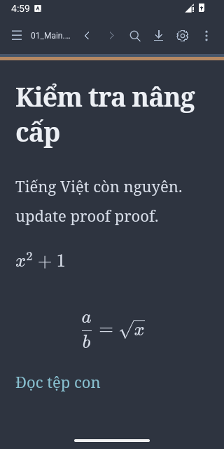

# P4C — Signed release upgrade validation

29/10/2026 · **PASS —44assertion native được nghiệm thu**. Cài đè release thật115→120 trên AVD riêng, không uninstall/clear data. Đây là kiểm thử APK phân phối trực tiếp, không liên quan Google Play.

## Baseline và candidate

- Baseline tải từ [GitHub tagv1.1.6](https://github.com/thanhnguyen0203/MarkRead/releases/tag/v1.1.6), asset `MarkRead-release-1.1.6.apk`; SHA `5a0ee4e950df4ca30963b0669337b7ab731f7b65c493be35cde9f3fad6eefa90`, khớp GitHub asset digest và APK dist1.1.5 local. **Metadata thực1.1.5/code115**, không lấy tên tag làm version Android.
- Candidate: APK Gradle release1.2.0/code120, package `vn.markread.local`, SHA **`a1ffba49a0e48008ba04e63b20baa35cfeaa2f69e8a0b8e844aa60a2743f5995`**.
- Cùng certificate SHA256 **`52a8a4d97bf264d0d43914f71408f6ccdaf6622951c55246157239aae13c2b54`**. Baseline/candidate đều non-debuggable. apksigner verifies, candidate v2 và zipalign đạt.
- AVD mới **MarkRead_P4C_Release /emulator5558**, system image API35 có sẵn,320×640/density160. Không dùng hoặc thay dữ liệu5554; AVD5556 debug trước đó cũng giữ nguyên. Không wipe data để vượt signature conflict.

## Cách quan sát và fixture

Fixture riêng `/sdcard/Documents/MarkReadP4C_20261029_a28c71` gồm `01_Main.md`, `Sub/02_Child.md`, bản xuất `03_SavedBefore.md` và `04_SavedAfter.md`. Có chữ Việt, link tệp con, inline/block LaTeX. Không tài liệu cá nhân.

Dùng app release nguyên bản và một APK instrumentation QA **riêng**, ký cùng certificate hiện có để Android cho phép instrument target non-debuggable. Helper chỉ ở ignored build, không đi vào app hoặc thư mục release. Không bật production WebView debugging, thay bridge/Java, dùng run-as/root để cấy settings hay mở rộng permission. Các controls được gọi qua handler DOM trong WebView thật; picker/grant/save dùng DocumentsUI thật. Key input là Android input, không gọi JS keydown simulation là IME test.

Helper dùng cache external riêng của app cho mailbox QA vì release không cho run-as; chỉ dọn hai file mailbox thuộc session này, không xóa preferences/draft/file. Preferences được thiết lập qua UI rồi mới đọc native appearance/grants để đối chiếu; không seed state trực tiếp nhằm làm migration PASS. Clipboard backup logic của helper tách khỏi artifact; không thu clipboard cá nhân.

## Trước update — đã xác minh

- Cài APK release cũ vào AVD mới trống, không thay bản debug hiện hữu.
- Tạo fixture; mở folder và nhấn **USE THIS FOLDER/ALLOW** trên SAF. Đọc nguồn chính exact, index tệp con.
- Qua Settings chọn **Nord, serif,22px, width720, leading1.9**, unified=false và áp CSS `#paper { border-top: 5px solid #b58863; }`. CSS parser cũ lưu canonical **`#paper{border-top:5px solid #b58863}`**; đây là giá trị stored so sánh trước/sau, không đòi giữ whitespace đầu vào chưa chuẩn hóa.
- Native SharedPreferences appearance ghi đủ những giá trị trên; persisted URI có read/write cho đúng tree. Reader border computed5px.
- Sửa bằng native textarea transaction thêm dòng tiếng Việt; source exact, export qua DocumentsUI thành03_SavedBefore.md. Hash khớp;01_Main.md ngoài app không bị ghi đè.
- Undo đưa nguồn về original exact và dirty marker thực sự tắt; chụp snapshot/persistence rồi kết thúc helper khi sạch. Bản sửa cần giữ đã được xuất, không thử update trên draft chưa bảo toàn.

## Cài đè

Thực hiện **`adb -s emulator-5558 install -r <candidate-release.apk>`**, không `-d`, uninstall hoặc clear data. Trước lệnh, target app không chạy; hash APK đang cài khớp baseline GitHub. Kết quả Success, **UID10209 giữ nguyên**, versionCode115→120; SHA của APK cài thực khớp candidate. Không lấy riêng installer Success làm data-retention proof.

[Install evidence](../../test-results/ui-p4c/UPDATE_INSTALL.json).

## Sau update — đã xác minh

- Native appearance JSON **giống giá trị trước update**, bao gồm theme/font/size/width/leading/CSS/options; persisted URI/read/write giữ nguyên.
- App khôi phục tree không hỏi cấp quyền lại, đọc01_Main.md exact, thấy tệp con và bản đã xuất.03_SavedBefore.md mở đúng source đã lưu; tệp con đọc exact.
- Reader áp Nord/serif và CSS border5px; Settings CSS hiển thị đúng canonical stored value.
- Search `proof` → Replace All `verified` trên source exact. **Một Undo Replace** về original, Redo trở lại replaced, Undo lần nữa về original.
- Android key input thêm ` P4C-input` vào editor release. Renderer chia chuỗi thành **2nhóm native Undo**; Undo/Redo đủ các nhóm khôi phục source exact, không đổi prefix gốc. Không hứa mỗi lần adb input hoặc mỗi chuỗi gõ luôn thành một nhóm.
- Thêm dòng Unicode bằng native editor transaction, export qua DocumentsUI thành04_SavedAfter.md; hash đúng expected. Original, tệp con và bản xuất trước update **không đổi byte**.
- Undo về sạch; Android Back đóng Search và giữ exact source. Cold relaunch tiếp tục giữ appearance/grants, mở original exact, chụp Reader/Settings.

Ảnh cùng viewport, nhưng UI mới có toolbar/typography khác và các thao tác Search/Source chủ động cuộn; không dùng ảnh này để cam kết pixel/scroll/caret persistence qua installer. Data proof là stored JSON/grants/source/byte hashes.

## Các attempt không được nhận PASS

[Raw QA attempts](../../test-results/ui-p4c/RAW_QA_ATTEMPTS.json) giữ5FAIL expectation trong quá trình thiết lập, tách khỏi44assertion cuối:

- Ba lần đọc “file export” trước khi DocumentsUI hoàn tất, trong lúc onboarding handwriting của Gboard che picker; output lỗi đọc chưa phải bytes file đã lưu. Sau khi đóng onboarding, tắt handwriting tạm trên AVD QA và xác nhận filename thật, save/hash mới được nghiệm thu.
- Helper từng dùng `.hidden` để nhận dirty của bản cũ, trong khi release cũ dùng `display:none`. Đã kiểm cả computed visibility lẫn exact source trước update.
- Helper ban đầu đòi một Undo xóa toàn chuỗi shell input; thực tế2nhóm. Đã đo/verify cả Undo và Redo đủ hai nhóm, giữ nguồn nguyên vẹn.

Các setup khác: CSS canonicalization khác whitespace input, selector mode thuộc `#workspace`, API35 dumpsys dùng appId và snapshot iframe có thể đang render. Đã sửa adapter/đường quan sát; không đổi editor, baseline bytes hoặc assert dữ liệu để bỏ qua lỗi. Mọi assertion cuối đều có expected/actual. Không có lỗi ứng dụng gây mất/sai Markdown trong luồng nghiệm thu.

## Cleanup, giới hạn và ý nghĩa PASS

Fixture cuối sạch, helper kết thúc; mạng trả1/1 ban đầu và hai namespace handwriting trả giá trị đã quan sát **null**. Đóng đúng AVD5558, giữ app/data/fixture phục vụ review; không uninstall/clear data hoặc đổi5554. Không force-downgrade để thử rollback.

Chưa thử máy thật/API26/OEM/provider khác hoặc mọi IME. P4C không lặp Gboard Telex/VNI đầy đủ; Unicode transaction/key input không được gọi là Telex acceptance. WebView version riêng của AVD mới chưa được chụp lại như một field environment; không tự gán số version từ evidence R2. TalkBack **NOT TESTED — accepted limitation**. Không đo FPS.

PASS áp dụng luồng release trực tiếp từ baseline đã nêu → APK SHA a1ff…5995 trên AVD này, với persistent Settings/CSS/SAF và file đã lưu. **Không** bảo đảm RAM draft/Undo/caret còn sau installer/process death, theo hợp đồng hiện có phải export trước update.

[44assertion và snapshot trước/sau](../../test-results/ui-p4c/UPDATE_VALIDATION.json). Luồng ký/build/update đạt, đủ điều kiện **READY FOR P4D** trong phạm vi APK trực tiếp; chưa upload.
