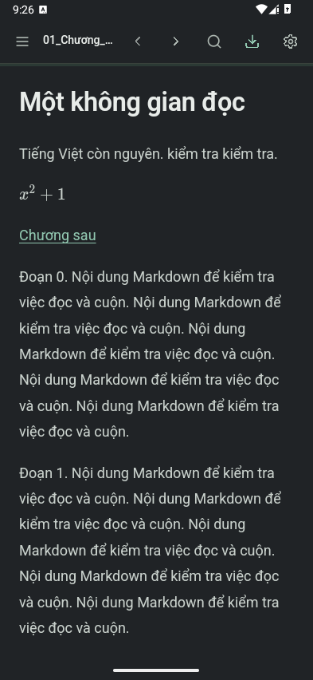
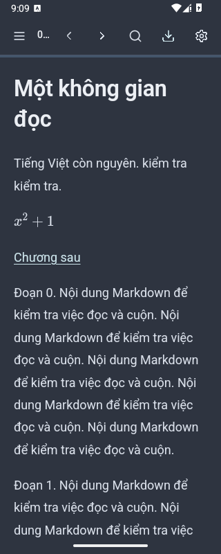
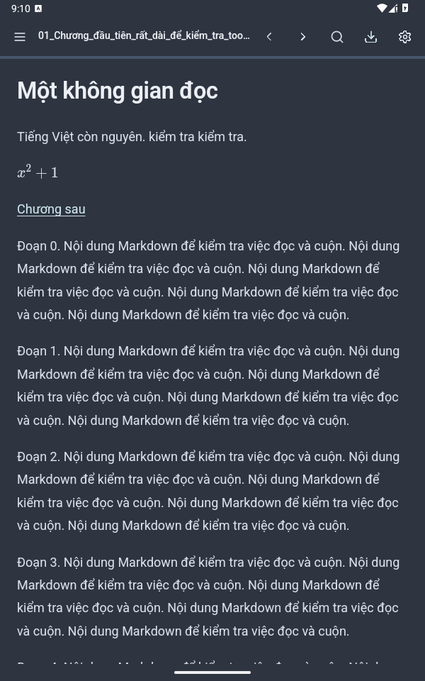
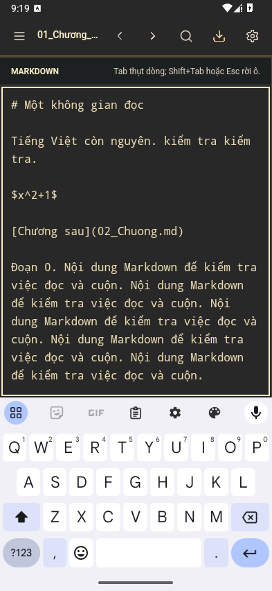

# Compact Reader Toolbar — Android Validation

29/10/2026 · **PASS các kiểm tra cuối trong phạm vi này; sẵn sàng để người dùng review và duyệt commit.** Chưa commit/stage/push, chưa tích hợp vào nhánh phát hành. Áp dụng skill `ui-ux-pro-max`, giữ hệ Quiet Ink và kiến trúc Java + WebView/HTML/CSS/JavaScript.

## Source và hiện trạng Git

- Branch: `codex/compact-reader-toolbar`.
- HEAD / commit nền: `82cc52a60e4b93495299ecac778322683b80b6f8`, chính là peeled commit của annotated tag `v1.2.0`. Parent source: `7b22e3eb91dcdc27aebe427c738fb37dcabe118c`.
- `git merge-base HEAD v1.2.0` bằng HEAD; thay đổi compact đang ở working tree phía trên source phát hành. Snapshot P4C/P4D đối chiếu **87/87 production inputs** của source nền; source compact chỉ khác đúng **5 production inputs UI/renderer** đã mô tả.
- Tag không di chuyển; APK release P4C SHA-256 vẫn `a1ffba49a0e48008ba04e63b20baa35cfeaa2f69e8a0b8e844aa60a2743f5995`.
- Không đổi Java, bridge, dependency, applicationId, version, signing/release config, manifest hay quyền. Không network/analytics mới. Không chạy uninstall hoặc clear data.

## Hoàn thiện trong lượt validation

Giữ toàn bộ implementation compact trước đó: một header56px; hamburger bên trái; tên file dùng khoảng còn lại/ellipsis; phải là previous → next → search → save → settings. Không còn overflow/menu ba chấm, hàng navigation thứ hai hay entry point block edit. Source Editor vẫn qua **Cài đặt → Đọc & chỉnh sửa → Chế độ tài liệu → Nguồn Markdown**. Các ID và action handlers của năm nút giữ nguyên.

Full regression phát hiện nút Save chưa đổi background khi nhấn: selector màu mặc định có độ ưu tiên cao hơn selector `:active` chung. Thêm đúng một quy tắc `#app>main>header .document-actions #download:not(:disabled):active`, dùng `--mr-pressed` và `--mr-text-primary`, rồi regenerate/sync Android asset. Kiểm thử pressed/cancel trên12theme của Reader suite xác minh bản sửa; không đổi logic xuất/lưu.

Phần còn lại là migration test theo UI đã được người dùng yêu cầu bỏ: helper chọn mode qua Settings; glyph header20px; kỳ vọng một hàng56px; xóa các hợp đồng chỉ dành cho inline block editor hoặc popup đã xóa, thay bằng kiểm không còn entry và sửa Source tương đương khi có thể. Không tạo DOM giả hoặc force-click menu cũ để làm test xanh.

## Kiểm thử đầy đủ và cách đếm

Đã chạy **tất cả30 browser suite P4C**, không chỉ nhóm843 trước đây. Bản gốc chạy trên source nền đã đối chiếu87inputs: **1.969/1.969 browser assertions PASS**. Trên compact, chạy lại đầy đủ30suite sau migration; những nhóm ngoài browser của P4C cũng chạy đủ:

- Node unit: **132/132**.
- JVM Policy/Session/NativeUi/Motion: **69 + 7 + 82 + 13 = 171/171**.
- Inherited APK contracts: **25/25**; launcher resources: **81/81**.
- Legacy signing guards: **5/5**; Gradle release signing negative contracts: **2/2** (missing store/wrong alias bị từ chối, release APK giữ nguyên). Cấu hình signing của worktree được đối chiếu byte với checkout/toolchain local chạy test này; không build hay ký lại release.
- Browser suites đã migrate: **1.918/1.918**.
- Tổng regression hiện hành: **2.334/2.334**; suite toolbar mới: **188/188**. **Tổng 2.522 PASS,0FAIL cuối**. Không có skipped test được cộng thành PASS.
- Palette: **2.220/2.220**, đủ12theme; debug APK security/packaging gate riêng: **18/18**.
- Android native checks hiện hành: **99/99**, tính riêng, không cộng vào2.522.

Baseline P4C đầy đủ là2.385 (2.383 cộng2integration signing guards). **Không tuyên bố2.385 assertion gốc giữ nguyên trên UI compact.** Số giảm ròng51 sau migration: UI54→50, Reading46→35, Keyboard68→58, Icons61→52, Motion surfaces98→86, Reader139→137, Polish75→72. Chủ yếu là inline node reuse/cancel/composition, choose-block navigator và overflow keyboard/motion/icon đã bị xóa theo yêu cầu. Các assertion khác cũng có chuyển đường vào hoặc thay hợp đồng; không suy diễn số bằng nhau nghĩa là byte-identical. Search/Dialogs160, Replace history68, source/native composition guards và các test dữ liệu/SAF policy vẫn được thực thi.

Motion reduced giữ đủ53: dùng PageDown thực tế trong reader để kiểm guard auto-hide/reveal sau đổi mode qua Settings, và Tab thực tế từ Save sang Settings để kiểm `focus-visible`. Reading suite vẫn kiểm wheel hide/reveal. Lần chạy full cuối có một lỗi harness motion; sau sửa kịch bản, chạy lại toàn bộ53 trên **cùng asset sản phẩm cuối**, tất cả đạt. Evidence giữ kết quả suite cuối theo tên, không cộng số PASS dở dang ở các attempt lỗi.

[Kết quả regression và từng suite](../../test-results/compact-toolbar-android/REGRESSION.json) · [Migration ledger](../../test-results/compact-toolbar-android/TEST_MIGRATIONS.json) · [Palette](../../test-results/compact-toolbar-android/PALETTE.json).

## Android runtime thực tế

AVD API35 / Android15 x86_64, **WebView124.0.6367.219**, instance QA riêng `MarkRead_CompactToolbar_API35` (`emulator-5560`). Dùng system image/toolchain sẵn có, không tải dependency. Instrumentation là APK QA riêng, không sửa target bridge/debug settings. Kiểm tra chữ ký QA khớp debug APK worktree; bản helper ký nhầm ở attempt đầu bị Android từ chối trước khi chạy, không phải lỗi MarkRead. Chỉ dùng folder/Markdown tổng hợp mới, không dùng nội dung cá nhân từ ảnh người dùng.

**PASS thực tế:**

- Viewport **320,360,393,412,600 CSSpx**, header một hàng56px; sáu icon controls48×48CSSpx, glyph20×20px; không overlap/overflow. Ở density đo160dpi, `devicePixelRatio=1`, `visualViewport.scale=1`, các kích thước này tương ứng48dp; đối chiếu thêm native accessibility bounds. Không suy diễn CSSpx luôn bằng dp ở mọi điện thoại.
- Tên tiếng Việt rất dài có ellipsis, accessible name đầy đủ; font scale Android130%/200% vẫn giữ thanh và các vùng chạm. Ở320px filename chỉ còn khoảng20px: **không đạt48px riêng cho nút tên file**, nhưng sáu icon không bị thu nhỏ/chồng lấn; đổi tên vẫn có file-row48px tương đương và F2. Với7target48px cần ít nhất336px trước cả gap, nên không thể giữ đủ7target48 trên320px. Nếu muốn tên rộng hơn cần thay phạm vi action/gesture ở lượt thiết kế khác; không đưa overflow trở lại.
- Đủ12theme có native screenshot; source nguyên vẹn qua đổi theme. Custom CSS thực tế áp dụng và vẫn thắng sau đổi theme; reset CSS QA qua UI sau kiểm.
- Previous/Next mở đúng fixture; Reader tap không tạo `.block-source`/inline editor và không sửa source; Source được chọn qua popup Settings thực tế và nhận focus.
- Gboard hiện ra; native key events nhập nhiều dòng ASCII bổ sung trên tài liệu tiếng Việt, Backspace/retype, clipboard Paste sentinel, Undo/Redo, Search/Replace và Undo/Redo sau Replace phục hồi đúng nội dung. Cho phép grouping native của chuỗi key events, không giả định một chuỗi luôn là một transaction.
- Back lần đầu đóng bàn phím, Back tiếp theo về Reader giữ draft; đóng Search/Settings/sidebar đúng lớp. Home/resume ngắn giữ file và nội dung chưa lưu. Reader swipe thực tế sau Source/Save/Back cuộn được.
- Các nút không còn `:active` sau thao tác. Palette/icon-state/Reader checks kiểm focus, pressed và cancel trên12theme.
- DocumentsUI chọn folder thật, grant SAF thật. Save tạo bản sao mới độc nhất trong chính folder QA, **9.991bytes**, SHA-256 `08de8f328c62d301d65ca9211bbce2276bce60d6d10b73f7448e8f58f674be14`, khớp source dự kiến byte-for-byte. Hai file gốc so sánh byte không đổi. Sau xuất, dùng Undo trả RAM draft QA về bản gốc; final dirty=false.

[Native checks và raw attempts](../../test-results/compact-toolbar-android/NATIVE.json) · [Trạng thái cuối](../../test-results/compact-toolbar-android/FINAL_STATE.json) · [Cleanup](../../test-results/compact-toolbar-android/CLEANUP.json).

Ảnh dưới là **ADB screencap trên emulator**, fixture tổng hợp; không phải Chromium mockup:







Folder evidence còn ảnh360/412, hai font scale và12theme. Không chỉnh sửa ảnh screencap.

## Build và APK cuối

Gradle8.9 + AGP8.7.3 + JDK17 + SDK35. Lệnh đã chạy (đường dẫn toolchain truyền qua biến local, không commit cấu hình máy):

```powershell
# Renderer hiện có; không install package.
Push-Location web
node build.mjs
Pop-Location
Copy-Item web/dist/MarkRead.html app/src/main/assets/index.html
./scripts/Build-AndroidDebug.ps1 -Offline -RerunTasks `
  -JavaHome $qaJdk -SdkRoot $qaSdk -GradleUserHome $qaGradleCache
git -c core.whitespace=blank-at-eol,blank-at-eof,space-before-tab,cr-at-eol diff --check
```

**BUILD SUCCESSFUL,31tasks thực thi,50s**. APK `app/build/outputs/apk/debug/app-debug.apk`, **7.636.685bytes**; SHA-256 **`6a5f1d5223cf66b4d6e96da2d8d27b34d336734efddbbdb0e0198d74c8e51f4c`**. Debug certificate SHA-256 `dfc1caf30a4cc1da2c4356d8d17cfa4880feaa9e59a31a1badbcb7846ce96c48`.

**Đây là DEBUG APK để QA**, version1.2.0/code120/appId `vn.markread.local`, min26/target35 giữ nguyên. Không dùng APK này cài đè bản release khác chữ ký đang có dữ liệu. Trên AVD riêng đã dùng `adb install -r`, không uninstall/clear; SAF/settings giữ lại. Đây không phải kiểm thử upgrade release chính thức cho phiên bản tiếp theo.

18gate xác minh apksigner, zipalign, CRC, đúng DEBUG variant, metadata,0permission, CSP hash/sandbox/offline assets/notices/parity, không signing material. Registry23Lucide offline/launcher assets đạt; chỉ kích thước CSS glyph toolbar đổi. Renderer SHA-256 `8f0d9b46fbac4230ff363f23f29e59575da0aa82a34417ad79d5c86d9b2f6805`; Android source asset và browser dist đồng nhất. Node syntax kiểm bundle và toàn bộ CJS tests đạt; diff check đạt theo CRLF policy của repo.

[APK gate](../../test-results/compact-toolbar-android/APK_CHECK.json) · [Build log](../../test-results/compact-toolbar-android/BUILD.log) · [Provenance](../../test-results/compact-toolbar-android/PROVENANCE.json).

## Giới hạn và quan sát cần giữ khi review

- **NOT TESTED:** điện thoại vật lý, WebView100 fallback runtime, Telex/VNI nhập tiếng Việt mới chuyên sâu, orientation bằng cảm biến, hiệu năng/FPS thực đo. Tài liệu tiếng Việt/caret/selection/history được kiểm nhưng native ASCII key events không được gọi là chứng nhận Telex/VNI.
- **TalkBack: NOT TESTED — accepted limitation** theo quyết định trước; semantics/ARIA/focus giữ nguyên.
- Trong đổi `wm size`/fontScale, Activity có lúc trở về welcome; grant và file list vẫn tồn tại, fixture sạch được mở lại qua UI file list. Những ảnh geometry không chứng minh RAM draft/history sống qua Activity recreation/process death. Home/resume ngắn được kiểm riêng với draft và đạt.
- Một lần sau debug update, host đang chạy nhiều browser QA, native startup watchdog hiện “Giao diện chưa sẵn sàng”. Đã chọn **Tiếp tục chờ**, không reload/clear, rồi hoàn tất các luồng. Chưa có phép đo để quy thành lỗi cold-start trên thiết bị thật; không cam kết tốc độ/FPS, cần theo dõi khi test máy thật. Có ảnh `startup-observation.png` để review.
- Raw attempts có lỗi setup helper signature, timing resize, theme card ngoài vùng cuộn, grouping Undo và đọc export bằng đường dẫn tương đối sai trong harness. Sửa harness, chạy lại kiểm tra tương ứng; không đánh dấu attempt FAIL là PASS. Native result99 là trạng thái kiểm tra hiện hành theo tên; hợp đồng grouping cũ ghi SUPERSEDED riêng.
- Đã dừng đúng AVD do lượt này tạo, khôi phục font/display overrides và clipboard QA. Dữ liệu AVD, grant và bản xuất thử nghiệm được giữ lại. Không đụng emulator/dữ liệu khác.

## File thay đổi và tích hợp

Các file tracked khác HEAD (gồm thay đổi compact đã có và test migration lượt này):

- `app/src/main/assets/index.html`
- `web/src/app.css`
- `web/src/app.js`
- `web/src/demo.md`
- `web/src/shell.html`
- `web/tests/accessibility-ui.cjs`
- `web/tests/foundations-ui.cjs`
- `web/tests/icon-states-ui.cjs`
- `web/tests/icons-ui.cjs`
- `web/tests/keyboard-native-ui.cjs`
- `web/tests/keyboard-ui.cjs`
- `web/tests/layout-helpers.cjs`
- `web/tests/library-redesign-ui.cjs`
- `web/tests/motion-controls-ui.cjs`
- `web/tests/motion-reduced-ui.cjs`
- `web/tests/motion-surfaces-ui.cjs`
- `web/tests/native-compatibility-ui.cjs`
- `web/tests/native-ui.cjs`
- `web/tests/overflow-ui.cjs`
- `web/tests/polish-ui.cjs`
- `web/tests/reader-redesign-ui.cjs`
- `web/tests/reading-ui.cjs`
- `web/tests/replace-history-ui.cjs`
- `web/tests/responsive-ui.cjs`
- `web/tests/revision-ui.cjs`
- `web/tests/search-dialogs-ui.cjs`
- `web/tests/search-ui-fixture.cjs`
- `web/tests/session-ui.cjs`
- `web/tests/settings-redesign-ui.cjs`
- `web/tests/ui.cjs`

File mới: `web/tests/compact-toolbar-ui.cjs` (188checks), báo cáo compact ban đầu và báo cáo này; evidence ở `test-results/compact-toolbar/` cùng `test-results/compact-toolbar-android/`. Chỉ5file production kể trên; phần mở rộng diff là test migration/documentation. Scratch/toolchain/helper APK không đưa vào Git.

**Đề xuất tích hợp sau khi được duyệt:** tạo commit coherent gồm5production files + test/helper migration/new suite; commit riêng docs/evidence nếu muốn review gọn. Vì branch đang nền đúng tagv1.2.0, áp dụng commit vào nhánh chuẩn bị phiên bản tiếp theo bằng merge thường hoặc cherry-pick, chạy lại gate trên kết quả tích hợp. Chọn versionCode lớn hơn120 trong bước release riêng; ký bằng release key cũ và kiểm update từ APK P4C khi chuẩn bị phát hành. Không sửa tagv1.2.0, không sửa APK đã ký, không force-push, không tự tạo GitHub Release.

Rollback trước commit: hoàn nguyên đúng5production files và các test đã migrate về HEAD82cc52a trên branch này; bỏ đúng file mới nếu quyết định hủy. Sau commit có thể revert commit compact để giữ lịch sử. Không reset/uninstall/clear dữ liệu người dùng hoặc di chuyển tag. **Dừng ở đây chờ người dùng review và phê duyệt commit.**
