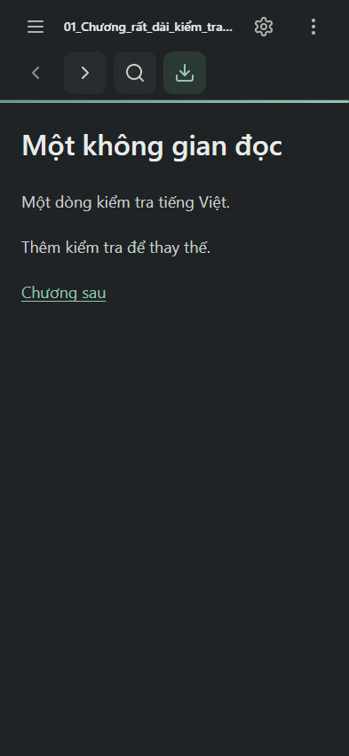
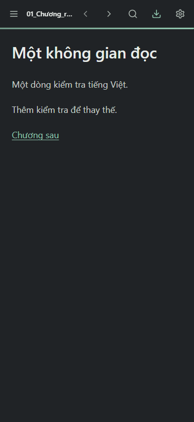
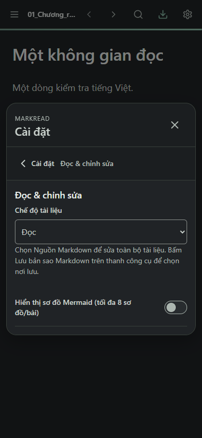

# MarkRead — Compact Reader Toolbar

> Báo cáo này ghi kết quả lượt implementation ban đầu. Android/full regression/APK cuối đã được xác minh bổ sung trong [COMPACT_TOOLBAR_ANDROID_VALIDATION.md](COMPACT_TOOLBAR_ANDROID_VALIDATION.md); dùng báo cáo mới cho quyết định commit.

29/10/2026 · **Hoàn tất thay đổi UI để review**, branch local `codex/compact-reader-toolbar`. Không commit/push hoặc sửa tag/Release GitHub. Không thay version/dependency/Java/bridge, APK P4C được giữ nguyên.

## UI cuối

Một hàng: **hamburger · tên file · previous · next · search · save · settings** trên điện thoại. Header56px; glyph Lucide20px thay24px, vùng chạm48×48CSSpx không chồng nhau. Chiều rộng CSS không được gọi là dp trên mọi thiết bị; native viewport/insets không đổi, cần xác minh density/runtime thật riêng. Desktop vẫn giữ sidebar cố định và hành vi ẩn hamburger cũ.

Không còn nút ba chấm/overflow trong DOM, hàng navigation riêng bên dưới, menu chọn block, thanh điều hướng block hoặc toggle hợp nhất trong Settings. Reader click/double click không gọi inline-edit; handler link nội bộ giữ nguyên. `beginInline` cũ còn ở source nhưng không có caller UI và có feature guard false. Preference `unified` cũ được giữ tương thích về lưu trữ nhưng không bật tính năng; cả true/false đều được kiểm.

Editor nguồn riêng được giữ tại **Cài đặt → Đọc & chỉnh sửa → Chế độ tài liệu → Nguồn Markdown**; Chia đôi vẫn có trên màn hình lớn. Đóng Settings sau chọn Nguồn đưa focus về đúng textarea, không thay editor/history engine. Escape ở editor đưa focus về Settings; Android Back vẫn về Đọc qua luồng cũ. Help và tài liệu mẫu được cập nhật để không hướng dẫn tới entry point đã bỏ.

Tên file có min-width0 và ellipsis, accessible name vẫn đầy đủ; không đẩy actions ra ngoài viewport. Ở320px tên hiển thị rất ngắn vì ưu tiên giữ48px cho sáu vùng chạm. Full name vẫn có trong accessibility/luồng đổi tên và danh sách tệp. Chữ nhãn200% vẫn nằm trong hàng56px. Không dùng outline:none toàn cục hoặc thu nhỏ touch target để ép layout.

## File sửa

- `web/src/shell.html`: gộp4actions và Settings vào một nav; bỏ overflow/block navigator/toggle; thêm selector chế độ trong Settings; sửa Help.
- `web/src/app.css`: bỏ grid mobile hai hàng, thêm quy tắc header56px, glyph20px/touch48px, title ellipsis/font scaling và visual states dựa trên tokens.
- `web/src/app.js`: gỡ popup/block UI wiring, vô hiệu reader block entry, giữ Source qua Settings và chỉnh điểm trả focus; giữ bindings ID của5actions.
- `web/src/demo.md`: thay hướng dẫn hợp nhất/ba chấm bằng Source trong Settings.
- `app/src/main/assets/index.html`: generated renderer đồng bộ `web/dist/MarkRead.html`.
- `web/tests/compact-toolbar-ui.cjs` mới:188assertions responsive/interaction/legacy settings/source/history/export/CSS.
- `web/tests/search-dialogs-ui.cjs`, `search-ui-fixture.cjs`, `replace-history-ui.cjs`: điều hướng Source qua Settings. History68assertions được giữ;3assertions về unified entry được chuyển thành kiểm legacy preference không mở UI và giữ Undo/Redo.
- `web/tests/icon-states-ui.cjs`: kỳ vọng glyph toolbar20px, giữ nguyên48px/centering/contrast/focus/pressed checks và tổng70assertions.
- Báo cáo này và evidence scoped ở `test-results/compact-toolbar/`.

## Kiểm thử

**843/843 assertions PASS,0FAIL cuối** =655 từ các suite regression được chọn +188mới. Không cộng palette/APK checks vào tổng này:

- Node unit132; Search/Dialogs160; Replace history68; startup53; icon states70; math release96; math QA36; math diagnostics36; empty-native-folder fixture4; compact toolbar188.
- Viewport320,360,393,412,600,768,844landscape,1280,1600; long filename, light/dark, enlarged label, header geometry/targets/ellipsis;12theme trong icon/math/palette checks.
- Mở/chuyển file và link nội bộ, next/prev disabled boundary, search/replace, source caret/selection Unicode, Undo/Redo sau Replace/typing, xuất bản sao byte exact, Settings/custom CSS precedence, focus và trạng thái search được kiểm bằng Chromium.
- **Palette2220/2220 PASS**,12theme. Registry23Lucide giữ nguyên; glyph nằm trên toolbar được thu bằng CSS, không thay SVG/dependency.
- **APK debug18/18 PASS**: metadata1.2.0/code120/appIdvn.markread.local/min26/target35, đúng variant DEBUG, signature, zipalign, CRC, renderer/notice parity, CSP/sandbox/offline, không private material trong APK; production diff chỉ5fileUI/renderer, P4C APK và tag không đổi.
- JS syntax và diff check (chấp nhận CRLF theo policy byte-preservation hiện có) đạt.

Các attempt đầu có lỗi setup QA dependency/encoding, selector theme trùng body và test helper còn gọi overflow/icon24px. Đã sửa setup/expectation theo UI mới rồi chạy lại toàn bộ các suite nêu trên trên asset cuối; không tính attempt FAIL là PASS hoặc bỏ assertion dữ liệu để giấu lỗi.

**Không chạy lại toàn bộ baseline2.385.** Các suite lịch sử khác còn ràng buộc overflow/unified UI cũ cần migration nếu dùng cho release gate tiếp theo. Không tuyên bố2.385/2.385 cho thay đổi này.

## Build và APK test

Gradle8.9, AGP8.7.3, JDK17, SDK35/cache có sẵn; không cài dependency. `Build-AndroidDebug.ps1` chạy offline, full rerun55s/31tasks thành công. Sau tinh chỉnh padding tên file, APK incremental hợp lệ nhưng giữ khoảng trống ZIP từ lần đóng gói trước, tăng dung lượng; đã đo compressed entries để xác định và chạy `:app:clean :app:assembleDebug` offline trong đúng worktree. **Build sạch cuối thành công16s/32tasks**; chỉ dọn output app/build đã kiểm đường dẫn, không sửa input, source gốc hoặc APK P4C. JDK/SDK/cache được truyền bằng parameters local, không ghi đường dẫn máy vào repo.

[APK debug](../../app/build/outputs/apk/debug/app-debug.apk): **7636681byte**, SHA-256 **`ec89a871e493eff2311c753831791ba207a1716a7272328ae749a1e5191ad024`**. Đây là APK debug để test, chữ ký khác APK release; không dùng nó cài đè bản release đang giữ dữ liệu.

`web/dist/MarkRead.html`, source asset và APK asset byte-identical. APK release P4C SHA a1ffba49a0e48008ba04e63b20baa35cfeaa2f69e8a0b8e844aa60a2743f5995 giữ nguyên; tagv1.2.0 vẫn trỏ82cc52a60e4b93495299ecac778322683b80b6f8. Không tạo APK release mới hoặc Draft/Publish.

## Ảnh và giới hạn

Ảnh **Chromium393×852, fixture tổng hợp**, không phải Android runtime/device:

**NOT TESTED trong lượt này:** chạy APK trên Android thật/emulator, Gboard/IME thật, TalkBack, SAF provider thật và FPS. MessagePort fixtures/keyboard insertText trong Chromium không thay cho các kiểm thử này. TalkBack vẫn NOT TESTED — accepted limitation theo quyết định trước, semantics/ARIA/focus hiện có giữ nguyên. Không hứa draft/Undo qua process death/update.

Evidence: [RESULTS](../../test-results/compact-toolbar/RESULTS.json), [188checks](../../test-results/compact-toolbar/COMPACT_TOOLBAR.json), [palette](../../test-results/compact-toolbar/PALETTE.json), [APK](../../test-results/compact-toolbar/APK_CHECK.json). Raw logs/setup ở ignored `build/toolbar-refinement/` của workspace QA gốc.

Rollback chỉ các file UI/test của thay đổi này về HEAD82cc52a trong branch riêng và bỏ đúng file/evidence mới nếu cần; không reset workspace gốc đang có thay đổi khác, không move tag hoặc uninstall/clear app data. **Dừng để người dùng review.**
