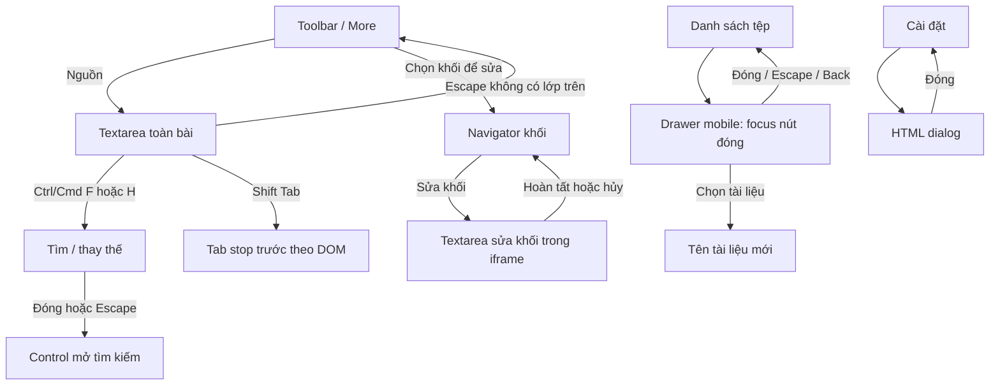

# P2C — Keyboard, Editor Focus & IME

**27/10/2026 · hoàn tất phần triển khai và kiểm thử tự động, chờ duyệt · dừng trước P2D.** Kiến trúc Java Android + WebView + HTML/CSS/JavaScript giữ nguyên. Kiểm nghiệm IME và lifecycle Android thật vẫn còn mở.

## 1. Điều kiện đầu vào

- HEAD đầu lượt: `7fe84d0` (`feat(ui): complete P2B accessibility improvements`); không có thay đổi tracked ngoài commit này. Các tài liệu P0/P2A, `tokens.js`, test token/foundations/accessibility và cache skill là đầu ra từ các lượt trước còn untracked. Chúng được kế thừa và bảo toàn.
- Có thêm file gốc `sibility improvements\uF022` (958 bytes), chưa rõ nguồn gốc. Đã báo trong chat và đối chiếu SHA-256 trước/sau: file giữ nguyên. Không sử dụng nội dung hoặc sửa/xóa file này.
- Đọc/đối chiếu P0, MASTER, COMPONENTS, ACCESSIBILITY, IMPLEMENTATION_PLAN, P2A_REPORT và P2B_REPORT. Dùng `ui-ux-pro-max` cho keyboard/focus; đối chiếu tài liệu DOM/IME trước khi chọn cách xử lý nhập liệu.
- **Chạy lại trước sửa: 546/546 đạt.** Node91, tám browser suite54+62+46+27+17+53+27+68, JVM69+7, APK25. Asset và web bundle khớp hash P2B `3efe92a9e0dd858ade0ab59ecce2e7bceebce758ca426da700f31809a1ef78ac`.
- Snapshot: `build/ui-p2c/before-p2c.zip`; manifest hash `before-sha256.json`; Git `git-before.txt`; log baseline trong `build/ui-p2c/before/`. Phân tích trước sửa được lưu riêng ở `build/ui-p2c/ANALYSIS_BEFORE.md`.

## 2. Implementation và những lỗi phát hiện

**Editor thật:** `#editor` là textarea toàn bài. Chế độ hợp nhất dùng `.block-source`, một textarea trong iframe cùng origin/sandbox, được tái sử dụng khi chuyển khối. Không có contenteditable, editor library hay formatting toolbar riêng.

Các nguy cơ đã xác định trước/qua kiểm thử:

1. Source và inline chặn mọi Tab, bao gồm Shift+Tab và modifier; Shift+Tab chèn hai space thay vì rời field. `setRangeText` không bảo đảm undo transaction của Chromium.
2. Không theo dõi composition. Escape, Ctrl/Cmd+Enter, shortcut toàn cục, Enter tìm/thay thế và Back có thể hoàn tất/hủy/chuyển UI khi IME còn đang soạn. Debounce preview/search có thể chạy trong composition.
3. `showFind(scroll:false)` vẫn đổi selection của source khi preview được dựng lại, kể cả khi người dùng đang gõ hoặc đã chuyển sang toolbar.
4. Escape có thể đóng find/sidebar phía sau dialog. Menu bị ẩn ngay trong keydown Tab có thể làm mất đích focus tự nhiên; popup có nhiều tab stop và chưa đủ Home/End.
5. Drawer chỉ ẩn subtree khi đóng; lúc mở chưa chuyển/giữ/trả focus hoặc cô lập main. Fallback WebView thiếu inert cần được kiểm tra.
6. Khi prev/next đang focus rồi bị disable tại biên danh sách, focus rơi về body. Split activation cũng có thể để focus ở menu item vừa bị ẩn.
7. Unified chưa có đường vào chỉnh khối bằng bàn phím. Các token dòng trống cấu trúc phải được loại khỏi navigator để không biến chúng thành mục sửa.
8. File transition chưa giữ view position trong RAM; callback composition cũ cần được chặn khi scope/session đã đổi.

## 3. Bản đồ focus và sự kiện

- **Input:** source giữ size guard5MiB, cập nhật source/draft/stats và debounce280ms; inline giữ `replaceBlock`, offsets, suffix và autosize. Trong composition, giá trị native được giữ trong textarea; đồng bộ source/preview/search chờ kết thúc.
- **Composition:** capture `compositionstart/end` trên document và reader iframe. `compositionupdate`, `beforeinput`, `keyup` tiếp tục do browser sở hữu; ứng dụng không viết lại thuật toán nhập dấu. Cuối composition chờ một microtask để nhận input cuối có thể đến sau end. Callback gắn epoch/path, nên callback từ scope cũ không ghi lại vào scope mới. Boundary scope đã được chấp nhận/expiry vẫn theo policy cũ và thu dọn trạng thái nhập cũ.
- **Keydown:** global workspace shortcut/Escape; source Tab; inline Tab/Escape/Ctrl+Enter; find/replace Enter; file F2; open/mode/font popup; Tab vòng trong drawer modal. Handler kiểm tra `isComposing`, `keyCode229` và trạng thái composition đã nhận; chỉ các phím thực sự được xử lý mới preventDefault.
- **Focus/blur:** beginInline chỉ focus khi cần vào field khác; input và iframe tiếp tục được reuse. Commit/cancel có chủ đích mới blur/tháo inline editor. Compositionend, preview, theme và viewport callback không tự focus lại editor. Menu focusout chờ native Tab chọn đích rồi mới đóng popup.
- **Resize:** ResizeObserver/resize giữ autosize hiện có; theo dõi thêm visualViewport resize. Với field vừa viewport nhưng bị khuất, chỉ cuộn nearest; không gán selection hoặc thêm keyboard padding. Field cao hơn viewport dựa vào hành vi caret/scroll native và cần thử thêm trên Android.

## 4. Luồng focus đã sửa

- Source Shift+Tab đi theo Tab order native, không sửa text. Escape khi source không có lớp trên chuyển tới More, giữ mode, selection và nội dung. Khi chọn Source rõ ràng, textarea nhận focus với preventScroll; chọn Read/Split trả focus tới control nhìn thấy.
- Popup open/mode/font dùng ArrowUp/Down/Home/End, một tab stop hoạt động, Enter/Space native và Escape trả trigger. Selected item bị ẩn bởi viewport không được chọn làm đích focus. Ctrl+Tab/Alt/Meta không bị drawer trap chiếm dụng.
- Drawer mobile là dialog modal có tên; mở focus nút đóng, cô lập main bằng inert khi có hỗ trợ. Fallback lưu/khôi phục tabindex và aria-hidden, cộng Tab loop/focus containment. Desktop vẫn là complementary landmark. Dialog HTML đang mở giữ quyền điều khiển focus riêng. Đóng trả trigger; chọn file chuyển tới tên bài, không tự vào textarea.
- Find mở bằng keyboard nhớ control gốc; đóng chỉ trả focus khi focus còn ở findbar. Query/navigation có chủ đích vẫn chọn match; preview nền không tự thay selection source. Shortcut tìm kiếm từ drawer đóng drawer trước khi focus search.
- Escape và Back xét popup trong lớp modal hiện tại trước; dialog trên cùng đóng riêng. Shortcut tài liệu không đưa focus vào workspace nằm sau HTML dialog. Native Back giữ chuỗi handled/dirty/exit; composition chưa xong trả handled; không đổi Java API hay cơ chế OS dismiss IME.
- Prev/next vừa bị disable chuyển focus sang nút điều hướng còn dùng được hoặc tên bài. Các thao tác trên toolbar không đưa focus trở lại editor ngoài ý muốn.
- Unified có menu “Chọn khối để sửa”, navigator transient với Khối trước/sau, Sửa/Hoàn tất, Hủy và Đóng. Dùng `beginInline/finishInline` hiện có, không thêm tab stop trên từng đoạn. Bỏ token phân cách chỉ chứa whitespace khỏi danh sách chọn; không thay source spans. Enter vào Sửa mới focus textarea; hoàn tất/hủy trả navigator, không tự mở lại IME. Navigator/marker nằm ngoài Markdown export.

## 5. Shortcut và bảo toàn editor state

- Giữ Ctrl/Cmd+O, S, F, H trong workspace; giữ F2/contextmenu/long-press, inline Ctrl/Cmd+Enter commit và Escape cancel. Shortcut tài liệu tôn trọng HTML modal hiện tại, Alt/AltGraph và IME. Không thêm tổ hợp phím mới.
- Tab thường vẫn chèn hai space. Dùng editing transaction `execCommand('insertText')` trên textarea đang focus để giữ undo trong Chromium, không blur/focus vòng. API này đã deprecated; [MDN](https://developer.mozilla.org/en-US/docs/Web/API/Document/execCommand) xác nhận trường hợp giữ undo buffer và yêu cầu kiểm tra tương thích. Nếu engine không hỗ trợ, giữ Tab navigation native và không dùng fallback gán text làm mất undo. Cần xác minh nhánh thụt dòng tại WebView100 trước phát hành.
- Guard229 theo [hướng dẫn keydown với IME](https://developer.mozilla.org/en-US/docs/Web/API/Element/keydown_event), gồm trường hợp compositionstart/end không trùng chính xác keydown.
- Selection, direction và scroll của view được giữ trong Map RAM theo file/source; chỉ khôi phục khi source còn khớp. Reader anchor do link yêu cầu được ưu tiên hơn vị trí nhớ. Đổi scope/forget xóa Map, rename chuyển key. Không thêm storage key, autosave hoặc persistence qua process restart.
- Source, dirty, draft RAM, offsets/suffix, theme/font/custom CSS và undo transaction hiện tại được giữ khi dùng toolbar, dialog, Tab, composition hoặc resize. **Không tạo undo stack xuyên tệp/khối.** Gán nội dung mới ở boundary tệp hoặc chuyển giữa các khối vẫn có giới hạn native undo như editor cũ; Map chỉ giữ view, không tuần tự hóa lịch sử undo.

## 6. File thay đổi

- `web/src/app.js`: composition/render/search guards; focus/keyboard/menu/drawer; navigator; view state RAM; generation guard và Back client UI.
- `web/src/keyboard.js` **mới**: helper IME, native indentation, focusable/isolation fallback, popup roving focus.
- `web/src/shell.html`: hint source và aria-describedby; command chọn khối và navigator ngoài reader. ID/bridge hiện có giữ nguyên.
- `web/src/app.css`, `web/src/paper.css`: hint, navigator và marker theo token P2A; không thêm motion hoặc đổi bộ icon/theme.
- `app/src/main/assets/index.html`: renderer sinh lại từ source.
- `web/tests/keyboard-ui.cjs`, `web/tests/keyboard-native-ui.cjs` **mới**.
- `web/tests/ui.cjs`: đổi một kỳ vọng cấu trúc unified — mode riêng bị ẩn, trigger công cụ vẫn dùng được. `web/tests/accessibility-ui.cjs`: đổi một kỳ vọng role sidebar mở từ complementary thành dialog modal. Giữ số assertions và kiểm tra chức năng cũ.
- Báo cáo này. Không sửa Java, Manifest, native.js, quy tắc parse Markdown/Marked/DOMPurify/KaTeX/Mermaid, SAF/file I/O, preference schema, package/lockfile hoặc tài liệu P0/P1/P2A/P2B. Hook render chỉ thêm guard và wiring cho focus/composition.

## 7. Kết quả kiểm thử trên bundle cuối

**630/630 kiểm tra tự động đạt, 0 fail**, phân tách:

- **546 kế thừa:** P0 439, P2A39, P2B68. Node91; browser UI54, Revision62, Reading46, simulated Native27, Session17, Startup53, Foundations27, Accessibility68; JVM Policy69, SessionPolicy7; APK validation25. Chạy lại cả trước sửa và sau sửa.
- **84 P2C mới:** `keyboard-ui.cjs`68 và `keyboard-native-ui.cjs`16. Bao phủ Tab/Shift+Tab/Escape, native undo/redo, default Backspace/Delete/Enter, multiline Unicode replacement, selection/scroll qua Settings và file navigation, reader scroll, Ctrl/Cmd shortcuts, menu/focus modal, inert fallback, unified navigation/commit/cancel, IME guards, late input, viewport và scope generation. Node unit tổng vẫn91; không cộng assert nội bộ thành test mới.
- **Palette 2.220/2.220**, đủ12 theme, 0 fail; đếm riêng khỏi630.
- `npm run build`, `node --check` app/helpers/test và CSS parse hai stylesheet: đạt, 0 lỗi. ECJ Java compile, D8, AAPT2, zipalign/check: đạt. APK không ký với asset mới qua25/25 validation, CSP/hash/font offline/zero permissions giữ nguyên. APK release cũ và chữ ký công khai verify đạt; không ký/cài/phát hành APK mới.
- `web/dist/MarkRead.html` và Android asset cùng SHA-256 **`8e90032a4afc44a82d8c2e5032cf7a562b314c207e4f3994ceb321e1bd119e89`**, 13.233.316 bytes. APK release cũ giữ SHA-256 `5a0ee4e950df4ca30963b0669337b7ab731f7b65c493be35cde9f3fad6eefa90`.
- Bằng chứng riêng tại `build/ui-p2c/`: log từng suite, native/Policy/APK, palette JSON. `workspace/test-results/ui-p2c/` chứa ảnh navigator và `composition-events.json`. `git diff --check` đạt; snapshot hash xác nhận các thay đổi thuộc đúng file đã liệt kê và file gốc không liên quan giữ nguyên.

**Phân biệt môi trường:**

- Browser thật là Chrome/Chromium cục bộ. `Input.imeSetComposition` và `Input.insertText` qua [Chrome DevTools Protocol](https://chromedevtools.github.io/devtools-protocol/tot/Input/) kiểm tra candidate “a→ắ”, “Vie→Việt”, commit/cancel và undo. Log có compositionstart/update, beforeinput/input với isTrusted=true; một số compositionend do protocol sinh có isTrusted=false. Các ca keyCode229 và input đến sau compositionend được dispatch tổng hợp riêng. Đây là mô phỏng input engine, không phải Gboard hay Telex/VNI thật.
- Native-facing test dùng MessagePort host mô phỏng, gọi đúng `markReadBack` và event expiry hiện có. Không chạy Activity, OS Back, ContentResolver hay SAF thật. Mô phỏng expiry kiểm tra callback composition cũ không ghi vào scope mới; không đổi ngưỡng10 phút hoặc policy process restart.
- **Chưa chạy Gradle assembleDebug:** không có Gradle8.9 cache/Gradle trên PATH và SDK đầy đủ được cấu hình; JDK/ECJ/AAPT2/D8 có sẵn được gọi bằng đường dẫn cụ thể. Không tải/install thêm toolchain.
- **Chưa chạy Android thật/emulator:** Gboard/Samsung keyboard, Telex/VNI, physical keyboard Android, OS clipboard Copy/Cut/Paste, khóa/mở khóa, home/return, rotation/IME/cutout thật, TalkBack, WebView100 và SAF/grants/provider. CDP multiline insertion không được gọi là kiểm thử paste OS; viewport resize không được gọi là mở keyboard Android.

## 8. Android viewport/lifecycle và rủi ro còn lại

- Manifest tiếp tục `adjustResize` và configChanges hiện có; API30+ root sở hữu union systemBars/IME insets, API26–29 dùng system window insets. CSS không cộng safe-area/IME padding. visualViewport chỉ cung cấp vùng thấy được cho scroll correction; không giả mọi WebView resize giống nhau.
- onPause/onResume/onStop/onStart và cơ chế session/picker exclusion Java không thay đổi. Không có focus restore khi resume/page show; preview có thể dựng lại theo baseline. Process bị đóng vẫn mất draft/undo RAM theo P0.
- Field inline lớn hơn viewport, composition ordering khác Chromium hiện tại, OS Back dismiss IME, rotation đang gõ và trở lại sau lock cần thử Android. Scroll nearest chỉ bảo đảm ca field vừa viewport đã đo; không tuyên bố đo được vị trí caret của mọi khối dài.
- `execCommand` là compatibility risk đã có fallback an toàn; thực nghiệm WebView100 và current là cổng phát hành. Undo xuyên tệp/khối nằm ngoài native transaction hiện tại, chưa được thêm thành chức năng mới.
- Navigator tăng chiều cao chrome chỉ khi người dùng mở. Không animation danh sách/paragraph hoặc thêm idle rAF; không benchmark5MiB/5.000 file trên Android. Popup/drawer fallback đã thử bằng cách tắt inert ở Chromium, vẫn cần TalkBack/WebView100 thật.
- Các lỗi native fallback/theme, scaling/layout/copy/feedback/motion ngoài P2C vẫn theo P0/P1. Giới hạn custom property CSS của parser P0/P2B giữ nguyên.

## 9. Rollback và điều kiện chuyển P2D

Rollback đúng P2C: khôi phục năm file production đã có (`app.js`, `app.css`, `paper.css`, `shell.html`, Android asset) và hai test cũ (`ui.cjs`, `accessibility-ui.cjs`) từ `build/ui-p2c/before-p2c.zip`; bỏ `keyboard.js` và hai test keyboard mới. Chạy lại web build; hash phải trở về P2B `3efe92a9...`, baseline546 đạt. Giữ nguyên token/test/P0 untracked đã có và file gốc không rõ nguồn gốc. Snapshot là bản sao local ignored; nếu muốn chia commit, cần đưa đầy đủ module/test thuộc từng giai đoạn vào Git. Lượt này không stage/commit.

Chỉ chuyển P2D khi chủ dự án duyệt P2C và các thay đổi kỳ vọng semantics/keyboard đã nêu; 546 kế thừa, 84 test mới, palette và bundle phải tiếp tục đạt. Trước tuyên bố hoàn tất nhập tiếng Việt trên Android hoặc phát hành native, cần test thiết bị với Gboard/Telex/VNI, hardware keyboard, OS Back/IME, lifecycle và SAF. Nếu yêu cầu undo xuyên tệp/khối, cần một phạm vi riêng để đánh giá tác động thay vì gọi Map view là lịch sử undo.

**Dừng tại P2C. Không triển khai P2D–P2G.**
