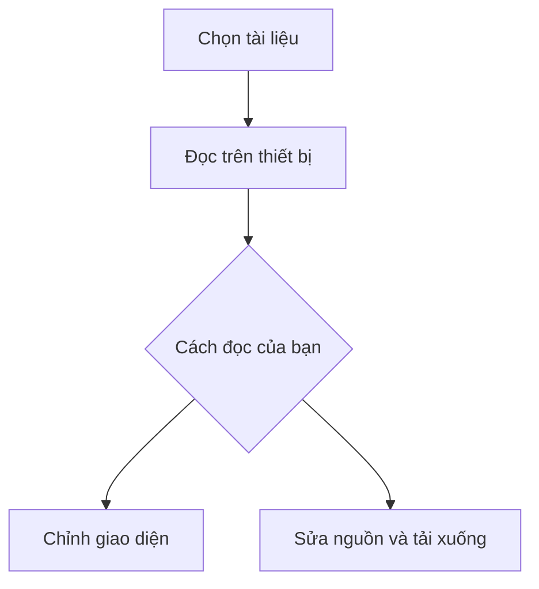

# Một góc yên tĩnh để đọc.

**Markdown của bạn. Giao diện của bạn.**  
Chọn một thư mục và bắt đầu đọc — mọi thứ được xử lý ngay trên thiết bị.

> Không cần tài khoản. Không gửi tài liệu đi đâu. Thư viện hiển thị công thức và sơ đồ đã được gói sẵn để dùng khi tắt mạng.

## Bắt đầu thật nhẹ nhàng

1. Bấm **+ Mở thư mục** để chọn nơi chứa tài liệu.
2. Mở nhánh thư mục con rồi chọn tài liệu. Dùng ‹ / › để chuyển bài; nút ⇅ đổi thứ tự tên trong danh sách.
3. Mở **Cài đặt** (biểu tượng bánh răng) để đổi theme, phông chữ, cỡ chữ hoặc thêm CSS.

Bấm **☰ → Mở thư mục**, chọn thư mục trong **Bộ nhớ trong** hoặc **thẻ nhớ** rồi cấp quyền đọc. Bạn cũng có thể dùng **Chọn tệp…**; chọn thêm ảnh nếu bài có ảnh.

## Một trang ghi chú, nhiều cách thể hiện

| Nội dung | Sẵn sàng để đọc |
| :--- | :--- |
| Văn bản | **In đậm**, *in nghiêng*, ~~gạch ngang~~ |
| Ghi chú | Danh sách, trích dẫn, bảng và mã nguồn |
| Công thức | Toán học nội dòng và công thức riêng |
| Sơ đồ | Mermaid được xử lý cục bộ |

Ví dụ xác suất có điều kiện: $P(A\mid B)=\dfrac{P(A\cap B)}{P(B)}$, với $P(B)>0$.

$$
\operatorname{Var}(X)=E[X^2]-\bigl(E[X]\bigr)^2
$$

```python
import pandas as pd

df = pd.read_csv("du_lieu.csv")
print(df.dropna().head())
```

## Theo dòng suy nghĩ



## Thêm một chút cá tính

Trong **Cài đặt → CSS riêng**, thử:

```css
#paper { max-width: 100%; }
h1 { letter-spacing: -0.04em; }
blockquote { border-radius: 8px; }
```

- [x] 12 theme, gồm Tokyo Night, Tokyo Night Light, Xanh xám, Nord và nhiều lựa chọn khác.
- [x] Công thức toán, sơ đồ và tô màu mã nguồn.
- [x] Chỉ đọc tệp được bạn chọn hoặc cấp quyền.
- [ ] Mở tài liệu đầu tiên của bạn.

---

*Bật Cài đặt → Đọc & chỉnh sửa → Hợp nhất Đọc và Nguồn để chạm vào từng khối và sửa ngay trong bài. Khi tắt hợp nhất, dùng thẻ “Nguồn” để sửa. Bấm ↓ và chọn nơi lưu bằng hộp lưu của Android; bản sửa chưa tải chỉ nằm trong phiên làm việc.*
